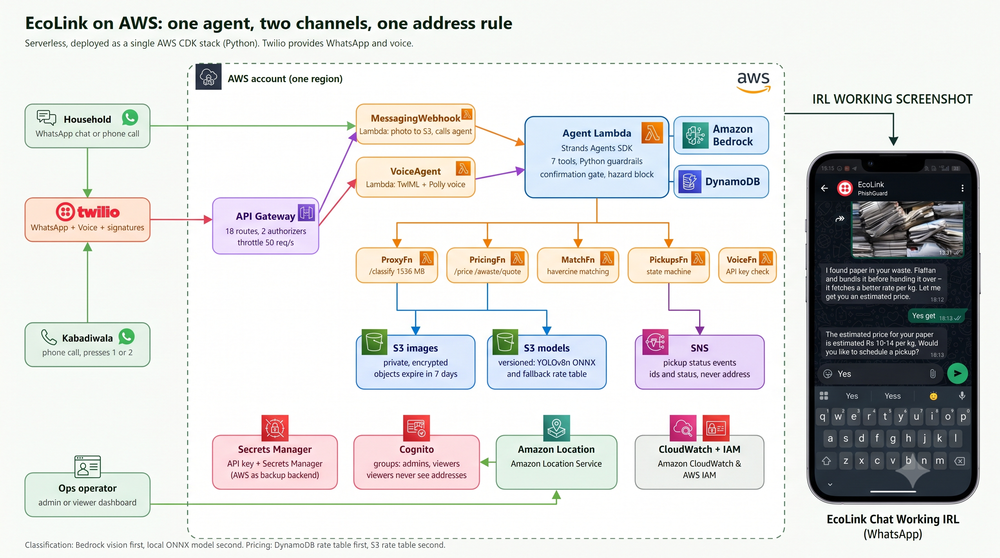
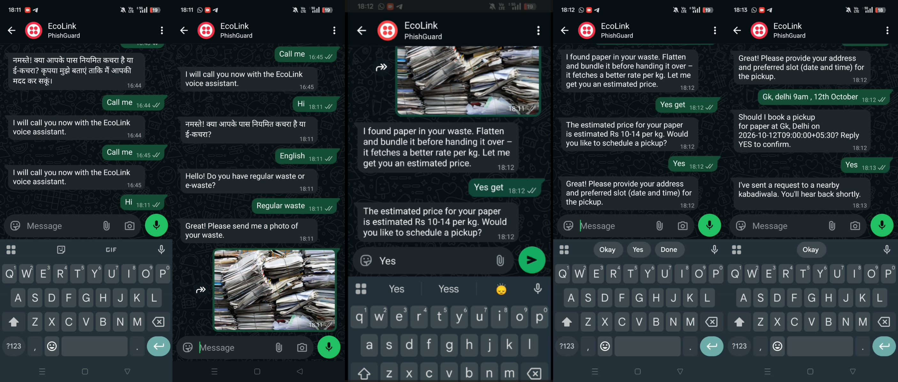

# EcoLink System & Operations

EcoLink is a WhatsApp-first assistant for household waste management. A household sends a photo (or describes an e-waste item) on
WhatsApp, gets an **estimated** price range, and, if they confirm, a nearby kabadiwala (scrap dealer) is **phoned** and presses 1 to accept
or 2 to decline. Both sides then get a confirmation message. Batteries and other hazardous items are never sent to a normal pickup; they go to
authorised drop-off points. A household's address is shared with a recycler only after the recycler accepts.

It is built with the Strands Agents SDK and AWS serverless services (Lambda, API Gateway, DynamoDB, S3, SNS, Cognito, Secrets Manager,
Bedrock), deployed with AWS CDK (Python). Twilio provides WhatsApp and voice.


*EcoLink on AWS: one agent, two channels (WhatsApp and voice), one address rule. The phone on the right is a real chat with the deployed stack.*


*The WhatsApp flow, recorded against the deployed stack: language choice, photo of waste, estimated price, address and slot confirmation, and the pickup request to a nearby kabadiwala.*

**Contents:** [How it works](#how-it-works) · [Repository layout](#repository-layout) · [Deploy the backend](#deploy-the-backend) ·
[AWS infrastructure in detail](#aws-infrastructure-in-detail) · [Run the frontend](#run-the-frontend) · [Conversation design](#part-a-conversation-design) ·
[Operations dashboard](#part-b-operations-dashboard) · [Landing page](#part-c-premium-saas-landing-page) · [Tests](#running-the-automated-tests)

---

## How it works

```
WhatsApp user ─► Twilio ─► API Gateway ─► MessagingWebhook Lambda ─► Agent Lambda (Strands + Bedrock) ─► reply via Twilio
                                │ photo copied to private S3          │ tools call this API with an API key:
                                ▼                                     ▼
                         S3 images bucket              /classify  /price  /ewaste/quote  /recyclers/match  /pickups  /voice/offer
                         (7-day expiry)                   │            │
                                                          │            └─► DynamoDB rate table (fallback: rate table in S3)
                                                          └─► Bedrock vision model (fallback: YOLOv8n ONNX model from S3)

Recycler phone ◄─ Twilio voice call ◄─ /voice/offer          presses 1 / 2 ─► /voice/response ─► pickup confirmed | declined
                                                                                                    ├─► address + confirmation sent to the recycler, confirmation to the household
                                                                                                    └─► SNS "pickup status" notification

Ops dashboard ─► /auth/login ─► Cognito ID token ─► /pickups, /dashboard/*  (admins see addresses; viewers do not until confirmation)
```

Rules enforced in code (not only in prompts): no booking without an explicit "yes"; every price is labelled an estimate; hazardous items
never go to a normal pickup; the household address reaches a recycler only once the pickup is `confirmed`; photos are private and expire after 7 days.

---

## Repository layout

```
EcoLink/
├── agent/                       # WhatsApp Strands agent (runs on Bedrock); also deployed by the CDK stack
│   ├── agent_core.py            # Guardrails: confirmation gate, hazardous filter, price formatting
│   ├── tools.py                 # 7 tools (classify, price, quote, recyclers, pickups, voice)
│   ├── state.py                 # DynamoDB conversation state with optimistic locking
│   ├── prompt.py                # System prompt (English & Hindi)
│   ├── lambda_handler.py        # AWS Lambda entry point
│   └── README.md                # Agent guardrails & assumptions
├── backend/                     # API, business rules, integrations (Python 3.12 Lambdas)
│   ├── ecolink/handlers/        # One Lambda handler per concern (pickups, voice, pricing, proxy, webhook, auth, ...)
│   ├── ecolink/core/            # Matching, address rule, pickup state machine, pricing, classifier, ML fallbacks
│   ├── ecolink/providers/       # MessagingProvider / VoiceProvider interfaces + Twilio adapter
│   ├── ecolink/schema.py        # The five DynamoDB tables (single source of truth)
│   └── README.md                # Backend guide: credentials, deploy, API reference, limitations
├── infra/                       # AWS CDK app (app.py, ecolink_stack.py, ml-layer/)
├── ml/                          # Vision (YOLOv8n weights, training/eval code) and pricing rate table
│   ├── vision/artifacts/weights # best.pt, best.onnx   -> uploaded to the models bucket by CDK
│   └── pricing/rate_table.json  #                      -> uploaded to the models bucket by CDK
├── conversation/                # WhatsApp flow & content design (flow.json, templates.json)
├── frontend/
│   ├── dashboard/               # Operations dashboard (vanilla JS + MapLibre GL JS; demo mode or live API via config.js)
│   │   ├── config.js            # git-ignored — copy from config.example.js and fill in your values
│   │   └── config.example.js    # committed safe template
│   └── site/                    # Landing page
├── scripts/                     # put_secrets, seed, reset, smoke_test, check_twilio, check_vision_fallback, serve_dashboard
├── docs/                        # API contract, architecture, conversation design, operations guide
├── tests/                       # Backend, ML, conversation and agent tests
├── .env.example                 # Every setting and credential the project reads (copy to .env)
└── README.md
```

---

## Deploy the backend

Full step-by-step guide, including where to get each credential: **[`backend/README.md`](backend/README.md)**. In short:

```bash
cp .env.example .env                    # fill in AWS + Twilio values (never committed)
python -m venv .venv && source .venv/bin/activate     # Windows: .venv\Scripts\activate
pip install -r infra/requirements.txt
python scripts/put_secrets.py           # Twilio credentials -> AWS Secrets Manager
cd infra && cdk bootstrap && cdk deploy # prints ApiUrl, TwilioMessagingWebhookUrl, UserPoolId, ...
cd .. && python scripts/seed.py         # 8 recyclers, a sample household, the rate table
python scripts/smoke_test.py            # real end-to-end checks against the deployed stack
```

Then paste `TwilioMessagingWebhookUrl` into the Twilio WhatsApp sandbox ("When a message comes in", method POST).
Use `python scripts/check_twilio.py` to verify your Twilio credentials and `python scripts/reset.py --yes` to restore the demo data.

---

## AWS infrastructure in detail

Everything below is created by **one CDK stack** (`infra/ecolink_stack.py`, stack name `EcoLinkBackend`) in one region and one account. Resource
names use the prefix `EcoLink` (setting `ECOLINK_PREFIX`). Nothing is created by hand except the Twilio secret, which `scripts/put_secrets.py` writes.

### At a glance

| AWS service | What the stack creates | Used for |
|---|---|---|
| **API Gateway** (REST) | `EcoLink-api`, stage `prod`, 16 routes, two authorizers, throttling 50 req/s (burst 100) | The single public entry point for the agent, Twilio, the dashboard and any API client |
| **Lambda** (Python 3.12, arm64) | 11 functions and 1 dependency layer (onnxruntime) | All business logic, the webhook, the agent itself |
| **DynamoDB** | 5 on-demand tables | Users, recyclers, pickups, price rates, conversation state |
| **S3** | `images` bucket (7-day expiry), `models` bucket (versioned) | Private household photos; ML weights and fallback rates |
| **SNS** | Topic `EcoLink-pickup-status` | Notification on every pickup status change |
| **Cognito** | User pool `EcoLink-dashboard`, groups `admins` / `viewers`, app client | Dashboard sign-in and read access control |
| **Secrets Manager** (or SSM) | `ecolink/api-key` (generated), `ecolink/twilio` (you create) | API key for the agent and API clients; Twilio credentials |
| **Bedrock** | No resource; IAM access to one model | Image classification and the agent's language model |
| **CloudWatch Logs** | One log group per function, 1-month retention | Debugging and the audit trail |
| **IAM** | One least-privilege role per function | Each function can touch only what it needs |
| **CDK bootstrap** | `CDKToolkit` stack: staging bucket, ECR repo, deploy roles | Uploads the Lambda code and model files during `cdk deploy` |

### API Gateway: routes and who may call them

Authorizers: **API key** = a Lambda authorizer that checks `Authorization: Bearer <key>` against the secret (cached 5 minutes); **Cognito** = the
user-pool authorizer (dashboard ID token); **signature** = the handler verifies the caller's Twilio signature itself.

| Route | Auth | Lambda | Called by |
|---|---|---|---|
| `POST /classify` | API key | ProxyFn | The agent's `classify_image` tool |
| `POST /agent/message` | API key | ProxyFn | API clients; the webhook calls the same code in-process |
| `GET /price`, `POST /ewaste/quote` | API key | PricingFn | The agent's price and quote tools |
| `GET /recyclers/match` | API key | MatchFn | The agent's `find_recyclers` tool |
| `POST /uploads/presign` | API key | UploadsFn | Clients that upload photos directly to S3 |
| `POST /pickups`, `PATCH /pickups/{id}` | API key | PickupsFn | The agent's `create_pickup` / `update_pickup` tools |
| `POST /voice/offer` | API key | VoiceFn | The agent's `offer_to_recycler` tool |
| `POST /voice/response` | Twilio signature, or API key (JSON body) | VoiceFn | Twilio, when the recycler presses a key |
| `POST /webhooks/messaging` | Twilio signature | MessagingWebhookFn | Twilio, for every inbound WhatsApp message |
| `POST /auth/login` | none (Cognito checks the password) | AuthFn | The dashboard login form |
| `GET /pickups`, `GET /pickups/{id}` | Cognito | PickupsFn | The dashboard |
| `GET /dashboard/recyclers`, `PATCH /dashboard/pickups/{id}` | Cognito (PATCH: `admins` only) | DashboardFn / PickupsFn | The dashboard |

Errors are always `{"error": "<code>", "detail": "<message>"}`. CORS is allowed for the origin in `CORS_ORIGIN`.

### Lambda functions

All run Python 3.12 on arm64 from the same `backend/` package (the agent has its own bundle). Defaults: 256 MB, 15 s.

| Function | Memory / timeout | Reads and writes | Notes |
|---|---|---|---|
| **AuthorizerFn** | 256 MB / 5 s | API key secret | Gatekeeper for every API-key route |
| **PickupsFn** | 256 MB / 15 s | `pickups` (read/write), `recyclers`, `users`, `rate-table` (read), SNS publish, Twilio secret | Create/update pickups, dashboard views, confirmation messages |
| **VoiceFn** | 256 MB / 15 s | `pickups` (read/write), `recyclers`, `users` (read), SNS publish, Twilio + API key secrets | Places the recycler call, handles the keypad response |
| **MatchFn** | 256 MB / 15 s | `recyclers` (scan) | Haversine matching by label, availability and distance |
| **PricingFn** | 256 MB / 15 s | `rate-table` (read), models bucket `pricing/*` (read) | Falls back to the rate table in S3 |
| **UploadsFn** | 256 MB / 15 s | images bucket `images/*` | Pre-signed upload and download URLs |
| **ProxyFn** | **1536 MB** / 28 s | Bedrock `InvokeModel`, models bucket `vision/*` (read), invoke the agent | `/classify` (Bedrock, then local ONNX model) and `/agent/message`; has the onnxruntime layer |
| **MessagingWebhookFn** | 256 MB / 60 s | `users`, images bucket, Twilio secret, invoke the agent | Inbound WhatsApp: stores photos, calls the agent, replies via Twilio |
| **AuthFn** | 256 MB / 10 s | none (Cognito sign-in is a public API) | Dashboard login |
| **DashboardFn** | 256 MB / 15 s | `recyclers` (scan) | Recycler list for the dispatch map |
| **EcoLink-agent** | 1024 MB / 60 s | `conversation-state` (get/put), API key secret, Bedrock `InvokeModel*` | The Strands agent (`agent/lambda_handler.py`) with its pip dependencies |

Layers: **ML layer** (onnxruntime, numpy, Pillow built for arm64; ~120 MB; used only by ProxyFn). CDK also adds two small helper functions for
uploading the model files and emptying buckets on `cdk destroy`.

### DynamoDB tables (on-demand billing)

| Table | Key | Indexes / TTL | Holds | Written by | Read by |
|---|---|---|---|---|---|
| `EcoLink-users` | `user_id` | none | Household profile: language, saved WhatsApp location | MessagingWebhookFn | PickupsFn, VoiceFn (language, distance), dashboard views |
| `EcoLink-recyclers` | `recycler_id` | none | Name, phone, location, accepted labels, availability | `scripts/seed.py` | MatchFn, VoiceFn, DashboardFn |
| `EcoLink-pickups` | `pickup_id` | GSI `by_status`, GSI `by_user` (both sorted by `created_at`) | Items, address, slot, status, status history, assigned recycler | PickupsFn, VoiceFn | PickupsFn, VoiceFn, dashboard |
| `EcoLink-rate-table` | `kind` + `item` | none | Scrap rates per kg, e-waste base values, condition factors | `scripts/seed.py` | PricingFn, dashboard value estimates |
| `EcoLink-conversation-state` | `user_id` | TTL attribute `ttl` (7 days) | Where each user is in the chat (owned by the agent) | Agent | Agent |

The table definitions live in `backend/ecolink/schema.py` and are shared by the stack, the scripts and the tests.

### S3 buckets

| Bucket | Settings | Contents and use |
|---|---|---|
| **Images** (`ImagesBucketName` output) | Private, SSL-only, encrypted, **objects expire after 7 days**, CORS for pre-signed uploads | WhatsApp photos copied here by MessagingWebhookFn (then deleted from Twilio); direct uploads via `/uploads/presign`. The classifier reads them through short-lived pre-signed URLs. Keys contain a hash, never a phone number. |
| **Models** (`ModelsBucketName` output) | Private, SSL-only, encrypted, **versioned** | `vision/best.onnx` (used at runtime), `vision/best.pt` (source checkpoint), `pricing/rate_table.json` (fallback rates). Uploaded from `ml/` on every `cdk deploy`. |

### SNS, Cognito, secrets and Bedrock

- **SNS** topic `EcoLink-pickup-status`: PickupsFn and VoiceFn publish `{pickup_id, status, previous_status, user_id, recycler_id, at}` on every change (never the address). Set `NOTIFY_EMAIL` in `.env` to subscribe an email address; anything else (SMS, a queue, a Lambda) can subscribe too.
- **Cognito** user pool `EcoLink-dashboard`: sign-up disabled (admins create users), optional authenticator-app MFA, groups `admins` (see addresses, can override status) and `viewers` (addresses hidden until confirmation). Used by `/auth/login` and the Cognito authorizer.
- **Secrets**: `ecolink/api-key` is generated by the stack; `ecolink/twilio` (account SID, auth token, WhatsApp sender, voice number) is written by `scripts/put_secrets.py`. Functions read them at runtime, so credentials never sit in the repo, the template or Lambda settings. If Secrets Manager is blocked on your account, set `SECRETS_BACKEND=ssm` to use encrypted SSM parameters instead.
- **Bedrock**: the stack grants only `InvokeModel` on the configured model (`BEDROCK_MODEL_ID`, default `apac.amazon.nova-pro-v1:0`). It is used by ProxyFn for image classification and by the agent as its language model.

### Where each part of the infrastructure is used, per flow

| Flow | AWS pieces touched, in order |
|---|---|
| **Customer sends "hi" or a photo** | API Gateway `/webhooks/messaging` → MessagingWebhookFn (reads Twilio secret, upserts `users`, copies photo to **images bucket**) → **agent Lambda** (reads/writes `conversation-state`, calls **Bedrock**) → agent tools call API Gateway with the API key (**AuthorizerFn**) |
| **Photo is classified** | `/classify` → ProxyFn → **Bedrock** vision; if Bedrock fails → local **ONNX model** downloaded from the **models bucket** |
| **Price estimate** | `/price` or `/ewaste/quote` → PricingFn → **`rate-table`**; if missing → `rate_table.json` in the **models bucket** |
| **User confirms a pickup** | `/pickups` → PickupsFn → **`pickups`** table → **SNS** `requested` |
| **Recycler is called** | `/recyclers/match` → MatchFn → **`recyclers`**; `/voice/offer` → VoiceFn → status `offered` (SNS) → Twilio places the call (offer text has no address) |
| **Recycler presses 1** | Twilio → `/voice/response` (signature checked) → VoiceFn → status `confirmed` (SNS) → address sent to the recycler, confirmation to the household (via Twilio) |
| **Operator opens the dashboard** | `/auth/login` → AuthFn → **Cognito** → ID token → `/pickups`, `/dashboard/recyclers` → PickupsFn / DashboardFn (address hidden for `viewers` before confirmation) |

### Cost, region and clean-up

- All services are pay-per-use. At demo volume the cost is dominated by Bedrock requests and Twilio; DynamoDB, Lambda, API Gateway, SNS and S3 are close to free. Set an AWS budget alert.
- The whole stack lives in one region (`AWS_REGION` in `.env`); it must be a region where your account may create these services and where your Bedrock model is available.
- `cd infra && cdk destroy` removes everything, including table data and both buckets, unless you deployed with `-c retain_data=true`. The `CDKToolkit` bootstrap stack stays.
- Tuning: Lambda memory and timeouts, throttling and log retention are constants in `infra/ecolink_stack.py`; `CLASSIFY_PRIMARY`, `BEDROCK_MODEL_ID`, `CORS_ORIGIN` and `NOTIFY_EMAIL` come from `.env`.

---

## Run the frontend

The EcoLink frontend (`frontend/`) is zero-build (vanilla HTML5, CSS3, ES modules, MapLibre GL JS): no bundler and no `npm install`.

### 1. Recommended method — dashboard dev server (injects Amazon Location key)

The Live Dispatch map uses **Amazon Location Service** tiles. The API key lives in `.env` and is injected at serve time — never committed.

```bash
# Add your Amazon Location API key to .env:
# AMAZON_LOCATION_API_KEY=v1.public.eyJ...

python scripts/serve_dashboard.py
```

Then visit:
- **Operations & dispatch console**: [`http://localhost:8000/dashboard/index.html`](http://localhost:8000/dashboard/index.html)
- **Public landing page**: [`http://localhost:8000/site/index.html`](http://localhost:8000/site/index.html)

> **Navigation**: the landing page's navbar and footer link to the **Ops Console**; the console header links back to **"← Back to EcoLink"**.

### 2. Plain static server (map tiles won't load without the key injection)

```bash
python -m http.server 8000 --directory frontend
```

### 3. Node alternatives

```bash
npx serve -l 8000 frontend
npx live-server frontend --port=8000
```

### 4. config.js — never commit it

`frontend/dashboard/config.js` is git-ignored. Each developer creates their own copy:

```bash
cp frontend/dashboard/config.example.js frontend/dashboard/config.js
# fill in baseUrl, cognito IDs, and set mockMode: false for live backend
```

### 5. Demo mode and live mode

The console starts in **demo mode** with built-in sample data, so it works with no backend:

| Role | Email | Password | Behaviour |
| :--- | :--- | :--- | :--- |
| **Admin** | `admin@ecolink.internal` | *(any value)* | Sees phone numbers and complete addresses at all times, and can override a pickup's status |
| **Viewer / Operator** | `ops@ecolink.internal` | *(any value)* | Address privacy enforced: addresses stay `[Hidden until confirmed]` until a recycler accepts |

To use the **deployed backend**, set `mockMode: false` and `baseUrl` to the `ApiUrl` output of `cdk deploy` in `config.js`, then sign in with a Cognito user (commands to create one are in [`backend/README.md`](backend/README.md)).

---

## Part A: Conversation Design

- **State machine (`conversation/flow.json`)**:
  - Regular waste and e-waste branches with language negotiation (English/Hindi).
  - Explicit confirmation check: pickups cannot be created until the user explicitly says YES / हाँ.
  - Automated routing for hazardous waste (batteries and hazardous e-waste go to authorised drop-off points, never a regular pickup).
  - Edge cases: blurry photos, unknown items, user cancellation, silence nudges, and recycler decline / no-answer handling.
- **Bilingual templates (`conversation/templates.json`)**:
  - Every message is under 300 characters for readability on mobile.
  - Interactive quick-reply buttons and WhatsApp list formats.
  - An unmissable **`🏷️ ESTIMATE`** tag wherever prices are quoted.
  - A recycler phone-offer voice script under 25 seconds (key 1 accept, key 2 decline) with no household address before acceptance.

---

## Part B: Operations Dashboard

The dashboard (`frontend/dashboard/`) is a lightweight, responsive JavaScript app with no build step; it can run locally or be hosted statically
(for example on S3 + CloudFront; the stack does not create that hosting).

1. **Cognito login** with permission groups: `admins` see raw address information; `viewers` have addresses hidden until a pickup is confirmed.
2. **Pickup fleet management**: live list with status chips (`requested`, `offered`, `confirmed`, `completed`, `declined`), search and status filters, summary cards.
3. **Master-detail drawer**: order details, item breakdown with an estimated value, and the status history.
4. **Live dispatch map**: MapLibre GL JS + Amazon Location Service tiles. Households, kabadiwalas and authorised drop-off facilities as colour-coded markers. Geolocation "You are here" pulsing marker. API key loaded from `.env` via `scripts/serve_dashboard.py` — never committed.
5. **WhatsApp Users tab**: live view of all household contacts joined with their conversation state and pickup count (`GET /dashboard/users`).
6. **Demo reset button**: restores the built-in sample data in demo mode. Against the live backend it is disabled; run `python scripts/reset.py --yes` instead.

---

## Part C: Premium SaaS Landing Page

The marketing page (`frontend/site/`) showcases the whole waste-dispatch pipeline:

- Oversized hero with floating WhatsApp chat, vision extraction and recycler-matching interfaces.
- A scroll-linked 5-step journey from the user's message to a confirmed pickup.
- A simulated IVR phone call with a single keypad response.
- A privacy section describing the 4-step address protection and zero-leakage rules.
- An animated serverless AWS architecture pipeline.

---

## Running the Automated Tests

```bash
# Backend, agent, conversation and ML-fallback tests (uses moto, an AWS emulator, plus a local HTTP server for Twilio)
pip install -r requirements.txt -r requirements-dev.txt
python -m pytest

# The vision/ML tests additionally need PyTorch and ultralytics (CPU is enough)
pip install torch==2.5.1 torchvision==0.20.1 --index-url https://download.pytorch.org/whl/cpu
pip install -r ml/vision/requirements.txt
```

- The backend tests run the **real handlers and boto3 code** against emulated AWS (DynamoDB with the real table schema, S3, SNS, SQS, Secrets Manager, SSM, Cognito), make real HTTP calls to a local server standing in for Twilio, and run the real `best.onnx` model. They include the unit tests for matching and the address rule, which fail if the rule is weakened.
- Not testable without real accounts: the Bedrock call itself, Twilio's media download, and live phone calls. `python scripts/smoke_test.py [--call]` checks those against a deployed stack.
- `tests/test_serving_handler.py` expects an `ml/serving/lambda_handler.py` that is not in the repository yet.
- `pytest.ini` disables a broken third-party `web3` plugin that some environments have installed.

---

## Part D: Conversational Voice Agent

EcoLink includes a phone voice agent that lets users call the EcoLink Twilio number and speak naturally — the same Strands agent core that powers WhatsApp handles the conversation, with Twilio speech-to-text and Amazon Polly TTS.

### How it works

```
User dials EcoLink number
        │
        ▼
Twilio → POST /voice/agent  (new call, no speech yet)
        │
        ▼
VoiceAgentFn → greeting TwiML (<Say> + <Gather speech>)
        │
        ▼  (user speaks)
Twilio → POST /voice/agent  (SpeechResult: "I have some paper and cardboard")
        │
        ▼
EcoLinkAgent.handle() → agent reply text
        │
        ▼
reply TwiML (<Say reply> + <Gather speech> for next turn)
        │
        ▼  (repeat until user says "bye" or hangs up)
```

### Key design points

- **Same agent, same state** — voice conversations share the DynamoDB `conversation_state` table; user IDs are prefixed `voice:+<E164>` so they never collide with WhatsApp IDs.
- **Bilingual TTS** — English uses Polly.Raveena (en-IN), Hindi uses Polly.Aditi (hi-IN). Language is auto-detected from the transcribed speech.
- **Goodbye detection** — if the user says "bye", "goodbye", "band karo" etc., the call ends gracefully.
- **Operator transfer** — if the user asks for a human, the call is transferred to `VOICE_TRANSFER_NUMBER` (set as a Lambda env var).
- **All guardrails apply** — confirmation gate, hazardous item block, and address privacy rules are identical to WhatsApp.

### Twilio setup (after `cdk deploy`)

1. Copy `TwilioVoiceAgentWebhookUrl` from the CDK stack outputs.
2. Go to **Twilio Console → Phone Numbers → your number → Voice Configuration**.
3. Set **"A call comes in"** → Webhook → paste the URL → **HTTP POST**.
4. Set **"Call status changes"** → paste `<url>/end` → **HTTP POST**.
5. *(Optional)* Set `VOICE_TRANSFER_NUMBER` on the `VoiceAgentFn` Lambda for operator transfer.

### New files

| File | Purpose |
|---|---|
| `backend/ecolink/handlers/voice_agent.py` | Lambda handler for inbound voice calls |
| `backend/ecolink/providers/voice_agent_twiml.py` | TwiML builders (greeting, reply, goodbye, error, transfer) |


### Video Link
[](https://youtu.be/aiS9fyoLE28)

