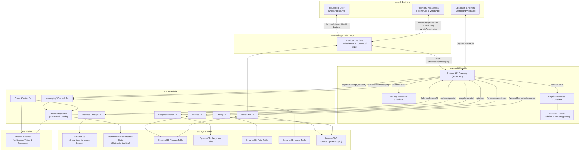
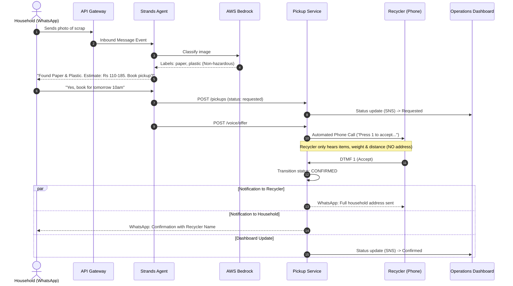

# EcoLink System Architecture

EcoLink is a WhatsApp-first assistant for household waste management and automated kabadiwala (recycler) dispatch, built on AWS Serverless infrastructure and the Strands Agents SDK.

---

## 1. High-Level Architecture Diagram

---

## 2. Core Subsystems

### 2.1 The Agent Subsystem (`agent/`)
- **Engine**: Strands Agents SDK running on AWS Bedrock (`us.amazon.nova-pro-v1:0` by default).
- **Core Guardrails**: Enforced programmatically in Python (`agent/agent_core.py`):
  1. **Confirmation Gate**: `create_pickup` requires `confirmed=True`, set only on explicit affirmative regex (`yes`, `haan`, `हाँ`, `theek hai`).
  2. **Hazardous Block**: Hazardous labels (`battery`, `ewaste`) cannot be scheduled for standard pickup. Diverted directly to safe drop-off centres.
  3. **Price Normalisation**: All price estimations are strictly normalised to `estimated Rs X-Y`.
- **State Management**: DynamoDB conversation store with versioned optimistic concurrency control (`agent/state.py`).

### 2.2 Backend & API Services (`backend/ecolink/`)
- **Handlers**:
  - `pickups`: Manages lifecycle transitions (`requested` $\rightarrow$ `offered` $\rightarrow$ `confirmed` $\rightarrow$ `completed`/`declined`/`cancelled`).
  - `pricing`: Rate calculation for regular scrap (Rs/kg) and depreciated resale valuation for e-waste.
  - `recyclers_match`: Haversine geospatial proximity query matching waste categories against recycler capabilities.
  - `voice`: Initiates automated IVR calls to recyclers and receives DTMF response callbacks (`1` to accept, `2` to decline).
  - `messaging_webhook`: Ingests WhatsApp media and user messages, invoking the agent.
- **Provider Interface**: Pluggable provider interface (`backend/ecolink/providers/base.py`) allowing zero-code switching between Twilio sandbox and native AWS SMS/Connect.

### 2.3 Operations Dashboard & Dispatch Console (`dashboard/`)
- **Authentication**: AWS Cognito User Pool with role-based group authorization (`admins` vs `viewers`).
- **Address Protection**: Non-admin dashboard viewers are prevented from accessing household addresses until a pickup is confirmed.
- **Visualisation**: OpenStreetMap / Amazon Location Service interactive live dispatch map with bounding box fitting.
- **Log Streaming & Telemetry**: Detailed audit trail of the Bedrock agent's decision-making and tool invocations, coupled with an interactive 4-stage lifecycle stepper.
- **Real-Time Client**: Zero-build vanilla architecture with client-side API abstraction (`api.js`) switching between mock demo state and live API Gateway endpoints.

### 2.4 Public Landing Page (`site/`)
- **Product Storytelling**: Editorial SaaS interface highlighting the end-to-end vision and dispatch journey.
- **Scroll Parallax & Animations**: Continuous 5-step visual flow linking photo classification, valuation, recycler matching, IVR offer, and pickup confirmation.
- **Interactive IVR Simulator**: Demonstrates the automated phone offer to recyclers with live DTMF keypad interaction.
- **Unified Navigation Bridge**: Direct link to the Operations Console (`/dashboard/index.html`) via navbar button and footer link.

---

## 3. Data Flow & Sequence Diagram

---

## 4. Key Security & Privacy Guarantees

1. **Address Privacy Rule**: Household address is stored only in DynamoDB. It is strictly never passed to any candidate recycler during matching or voice offers. Address details are dispatched to the recycler **only after** they press `1` to confirm acceptance.
2. **Media Retention Policy**: S3 lifecycle rules automatically delete uploaded waste photos after 7 days.
3. **Least Privilege IAM**: Granular AWS IAM roles restrict Lambda functions to specific DynamoDB table partition keys, S3 prefixes, and Bedrock model ARNs.

