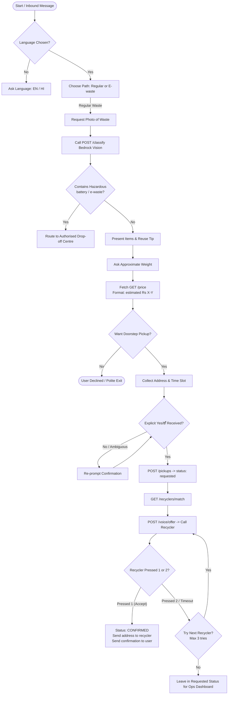
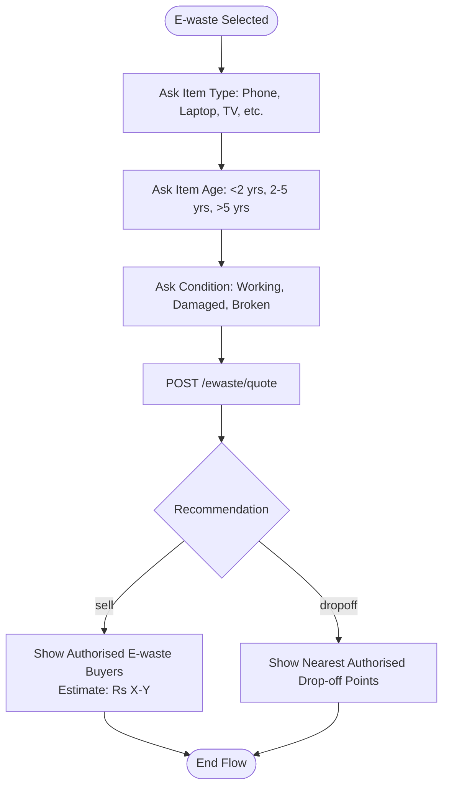

# EcoLink Conversation & Guardrails Design

This document details the WhatsApp interaction flow, user experience guidelines, safety guardrails, and multilingual conversational logic.

---

## 1. Flow Diagrams

### 1.1 Regular Waste Flow

### 1.2 E-Waste Flow

---

## 2. Hard Python Guardrails

The conversation relies on programmatic guardrails enforced in code (`agent/agent_core.py`), ensuring safety regardless of LLM generation:

1. **Confirmation Gating**:
   - `create_pickup` is blocked until `confirmed=True`.
   - The flag is only flipped when user input matches `_YES_PATTERN` (`yes`, `yep`, `हाँ`, `haan`, `theek hai`, etc.).
2. **Hazardous Label Blocking**:
   - Any pickup containing labels in `HAZARDOUS_LABELS` (`battery`, `ewaste`) is blocked by the agent and rejected with `422 Unprocessable Entity` by the backend.
3. **Price Normalisation**:
   - Enforced by regex transformation to guarantee the presence of the word "estimated" (e.g. `estimated Rs 120-180`).
4. **Address Secrecy**:
   - Address fields are never sent in the recycler matching payload or voice offer payload. They are sent via WhatsApp only after the status is `confirmed`.

---

## 3. Bilingual Template Specifications

All message strings are maintained in `conversation/templates.json` under strict limits:
- **Maximum characters**: 300 characters per text bubble.
- **Button limits**: Up to 3 quick-reply buttons (title $\le 20$ chars).
- **List picker**: Up to 10 rows (title $\le 24$ chars).
- **Recycler phone call**: Script length $< 25$ seconds in both English and Hindi.

